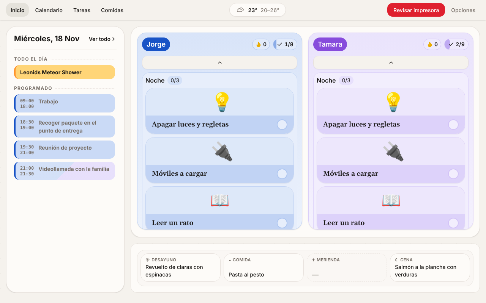
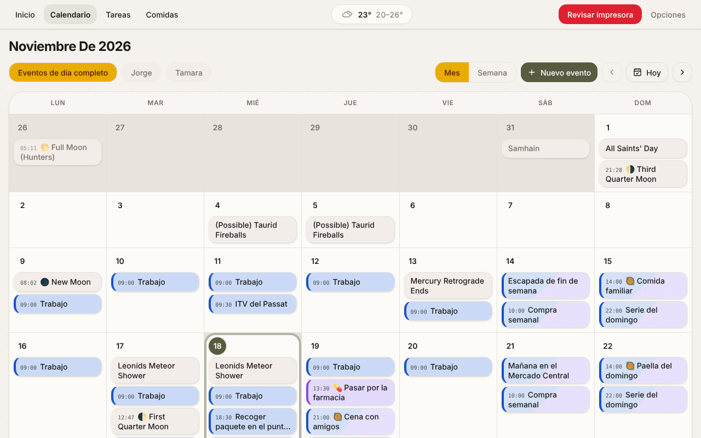
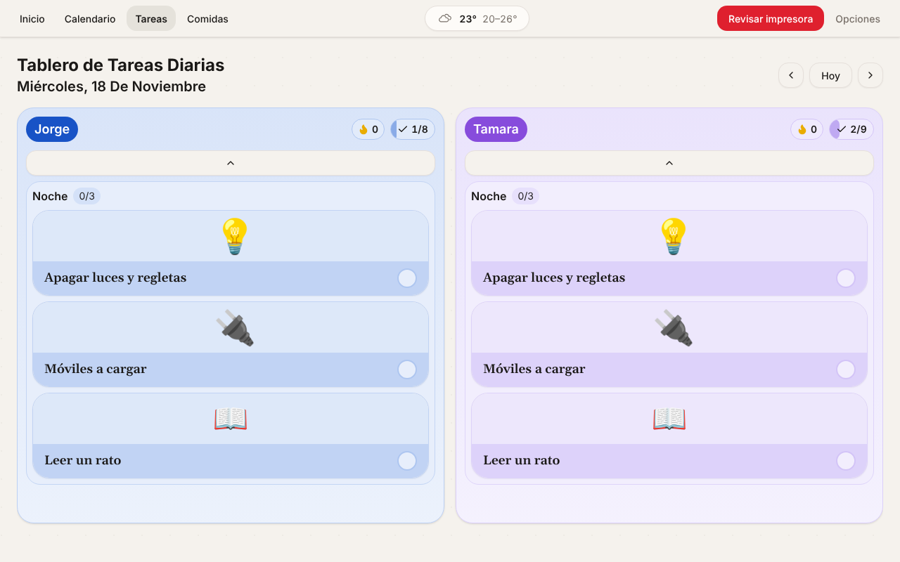
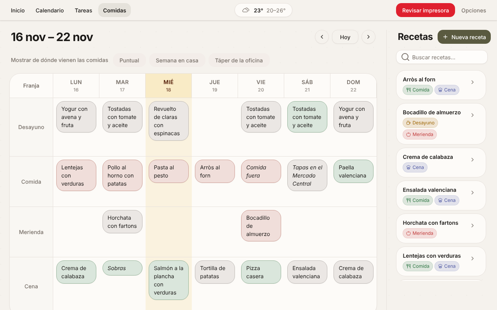

# Marplanner · versión casa

Fork de [diegomarino/marplanner](https://github.com/diegomarino/marplanner) adaptado a un hogar
en Valencia: en español, con el tiempo de Aldaia y pensado para una pareja (Jorge y Tamara) en
lugar de una familia con niños. Todo lo que trae de ejemplo se cambia desde **Opciones →
Administración** (PIN), así que sirve también para que un amigo lo monte con su casa.



| Calendario                                   | Tareas                                 | Comidas                                |
| -------------------------------------------- | -------------------------------------- | -------------------------------------- |
|  |  |  |

## Qué cambia respecto al original

**1. Las tareas ya no son solo para niños.** En el original, una rutina solo se podía asignar a
un miembro con rol «menor», así que en una casa de adultos el tablero de tareas salía vacío.
Ahora se puede asignar a cualquier miembro activo. En el tablero salen siempre los niños (como
antes) y los adultos **solo si tienen alguna rutina asignada**: una familia con niños se ve
exactamente igual que en el original, y una pareja ve una columna por persona.

**2. Perfil de datos «casa».** Al arrancar con la base de datos vacía, se rellena con un hogar
de ejemplo en lugar de los Simpson:

- Jorge y Tamara, idioma español, semana empezando en lunes, tiempo de Aldaia.
- Rutinas de casa repartidas por días: mañana, entreno, cocina y cena, cerrar el día y
  limpieza del finde.
- Menú semanal y táper de la oficina con recetas caseras (paella, arròs al forn, lentejas…).
- Recordatorios (llaves, táper, reciclaje los martes y viernes, lista de la compra…) y algunos
  que solo aparecen cuando hay un evento relacionado (ITV, cumpleaños, ruta).
- Calendario con festivos de España y eventos de ejemplo de la semana pasada, la actual y la
  siguiente, para que siempre haya algo que enseñar.

Los cumpleaños y eventos son de ejemplo: cámbialos o bórralos en Administración.

**Por qué un perfil aparte y no sustituir a los Simpson:** el autor tiene ~30 pruebas
automáticas que comprueban la demo de los Simpson. Dejándola intacta en `seeds/` y poniendo la
casa en `seeds-casa/`, esas pruebas siguen pasando y puedes traer actualizaciones del original
sin conflictos. Puedes elegir cuál usar con `MP_SEED_SET=casa` (por defecto) o
`MP_SEED_SET=simpsons`.

## Montarlo en tu servidor (Docker)

Necesita un proceso siempre encendido y un disco donde guardar la base de datos (SQLite en el
volumen `/data`). Por eso Vercel no vale y un servidor propio sí.

```sh
git clone https://github.com/J7Auto/marplanner.git
cd marplanner
cp infra/docker/.env.example infra/docker/.env.local
```

Edita `infra/docker/.env.local`:

```sh
MP_ACCESS_TOKEN=mpg-<cadena aleatoria larga>      # contraseña para abrir la web
MP_BOOTSTRAP_KEY=mpk-<otra cadena aleatoria>      # para dar de alta cada tablet/navegador
MP_ADMIN_PIN=<PIN numérico, p. ej. 4 cifras>       # PIN de Administración
MP_SEED_SET=casa
MP_SEED_ON_EMPTY=true
PUBLISHED_HOST=0.0.0.0                            # para entrar desde la red de casa
PUBLISHED_PORT=3000
```

Para generar las cadenas: `echo mpg-$(openssl rand -hex 24)` y `echo mpk-$(openssl rand -hex 24)`.

```sh
docker compose --env-file infra/docker/.env.local -f infra/docker/compose.yaml -p marplanner-casa up --build -d
```

Abre `http://<ip-del-servidor>:3000`, mete el `MP_ACCESS_TOKEN` y luego el `MP_BOOTSTRAP_KEY`
para registrar ese dispositivo. Haz esto una vez en la tablet de la pared.

- **Los datos de ejemplo solo se cargan la primera vez** (con la base de datos vacía). Después
  `MP_SEED_ON_EMPTY` no toca nada, así que puedes dejarlo puesto.
- **Fuera de casa:** no abras el puerto a Internet. Lo cómodo es Tailscale (o tu VPN) y entrar
  por la IP de Tailscale. Si lo publicas con dominio, ponlo detrás de un proxy con HTTPS
  (Caddy, Nginx Proxy Manager, Traefik). Más detalle en [SECURITY.md](SECURITY.md).
- **Actualizar:** `git pull` y el mismo `docker compose … up --build -d`. Los datos viven en el
  volumen `marplanner-casa_marplanner-data` y no se pierden.
- **Copias de seguridad:** activa el plugin «Copias de seguridad» en Administración → Plugins.

## Para enseñarlo a amigos

- **Rápido:** que lo vean en tu tablet o entren a tu instancia por Tailscale.
- **Su propia casa:** que clonen este repo y sigan los pasos de arriba. Arranca con Jorge y
  Tamara de ejemplo; en Administración → Miembros cambian nombres y añaden niños, y en el resto
  de secciones rutinas, comidas y recordatorios. Si prefieren empezar con la demo original,
  `MP_SEED_SET=simpsons`.

## Extras opcionales

- **Briefing impreso** cada mañana en una impresora térmica Bluetooth barata (ESC/POS), desde
  el navegador de la tablet. Algunos bloques (chiste, adivinanza, sopa de letras) solo existen
  en inglés.
- **Anuncio hablado de la hora** a las horas que configures.
- **Feeds de calendario** (ICS): añade tu Google Calendar o el de Valencia CF en
  Administración → Calendario.
